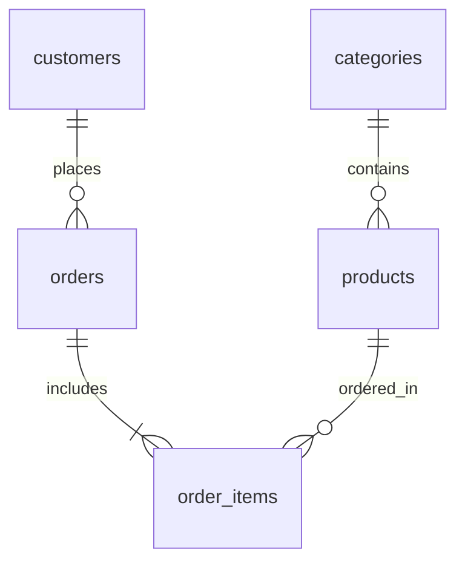

# Veloce Market — React E-Commerce UI & 5-Table ERD

Modern, responsive **React + Tailwind CSS v4 E-Commerce UI** and **5-table relational ERD** (`docs/ecommerce-erd.drawio`) built to match the Practical Exercises and ready for **Laravel API (Steps 3–6)**.

---

## Features (Step 1)
- **Storefront (`/`)**: Displays the 4 products (**Laptop $650**, **Mouse $15**, **Keyboard $25**, **Monitor $120**) with category filtering, search, sorting, and **Add to Cart** buttons.
- **Shopping Cart Page (`/cart`)**: View Cart, Update QTY (`-` / `+`), Remove item, Subtotal & Grand Total calculation, and **Proceed to Checkout** button.
- **Checkout & Order Confirmation (`/checkout`)**: Customer checkout form (`First Name`, `Last Name`, `Email`, `Phone Number`, `Address`, inline required-field validation, `Free Shipping $0` / `Express Shipping $9`), **Place Order** button, and full Order Confirmation receipt (`Order Placed Successfully!`, `ORD-0001`, Customer Name, Order Date, Ordered Products, Total Amount, `Order Status: Pending`).
- **Catalog Management Console (`/admin`)**: Full CRUD modals for **Products** and **Categories** matching every ERD column.
- **Interactive 5-Table ERD Viewer (`/erd`)**: Visual schema breakdown for `customers`, `categories`, `products`, `orders`, and `order_items` + one-click `.drawio` download for [app.diagrams.net](https://app.diagrams.net/).

---

## 5-Table ERD (`docs/ecommerce-erd.drawio`)

To view or edit the visual diagram on **diagrams.net**:
1. Open [https://app.diagrams.net/](https://app.diagrams.net/)
2. Click **File → Open from → Device...**
3. Select [`docs/ecommerce-erd.drawio`](./docs/ecommerce-erd.drawio)



Full column dictionary and API contract: [`docs/ERD.md`](./docs/ERD.md).

---

## Local Development

```bash
npm install
npm run dev
```

Build for production:
```bash
npm run build
```

---

## Connecting to Laravel API (Step 6)

When your Laravel backend (`php artisan install:api`, `categories` & `products` endpoints, and Database Seeders) is running at `http://127.0.0.1:8000`:

1. Update `.env`:
   ```env
   VITE_API_BASE_URL=http://127.0.0.1:8000/api
   VITE_USE_MOCK_DATA=false
   ```
2. Restart `npm run dev` — all storefront and admin CRUD requests in `src/services/` will automatically switch to your live Laravel API.
