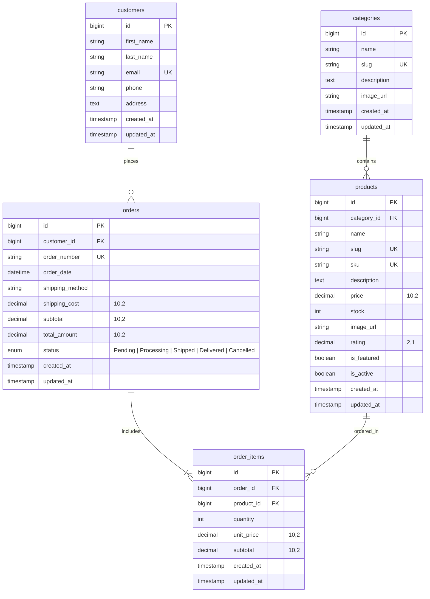

# 5-Table E-Commerce Order Database ERD

> **Draw.io / diagrams.net File:** [`docs/ecommerce-erd.drawio`](./ecommerce-erd.drawio)
> Open directly at [https://app.diagrams.net/](https://app.diagrams.net/) (`File` → `Open from` → `Device...` → select `docs/ecommerce-erd.drawio`).

---

## Visual Diagram (Mermaid)

---

## Relationships Summary

| Parent Table | Child Table | Foreign Key | Cardinality | Laravel Eloquent |
| :--- | :--- | :--- | :--- | :--- |
| `customers` | `orders` | `orders.customer_id` | 1 : 0..N | `Customer hasMany Order` / `Order belongsTo Customer` |
| `categories` | `products` | `products.category_id` | 1 : 0..N | `Category hasMany Product` / `Product belongsTo Category` |
| `orders` | `order_items` | `order_items.order_id` | 1 : 1..N | `Order hasMany OrderItem` / `OrderItem belongsTo Order` |
| `products` | `order_items` | `order_items.product_id` | 1 : 0..N | `Product hasMany OrderItem` / `OrderItem belongsTo Product` |

---

## Laravel API Integration Contract (Steps 3–6)

| Method | Endpoint | Purpose | Used By Frontend |
| :--- | :--- | :--- | :--- |
| `GET` | `/api/categories` | List all categories | Storefront filter & Admin |
| `POST` | `/api/categories` | Create a new category | Admin Console |
| `PUT` | `/api/categories/{id}` | Update a category | Admin Console |
| `DELETE` | `/api/categories/{id}` | Delete a category | Admin Console |
| `GET` | `/api/products` | List products (supports `?category_id=&search=`) | Storefront & Admin |
| `GET` | `/api/products/{id}` | Single product details | Product Detail Page |
| `POST` | `/api/products` | Create a product | Admin Console |
| `PUT` | `/api/products/{id}` | Update a product | Admin Console |
| `DELETE` | `/api/products/{id}` | Delete a product | Admin Console |
| `POST` | `/api/orders` | Submit customer + order + `order_items` | Checkout Page |
